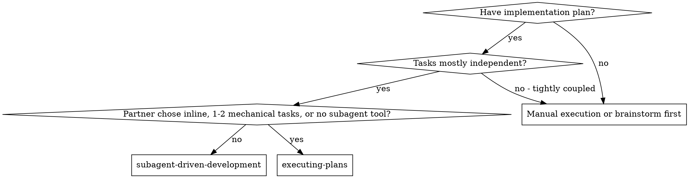

# Subagent-Driven Development

Execute a plan with a fresh implementer subagent per task, risk-based task
reviews, and a mandatory broad whole-branch review at the end.

**Why subagents:** Fresh agents receive deliberately scoped context instead of
session history, keeping them focused and preserving controller context.

**Core principle:** Fresh subagent per task + review proportional to risk +
mandatory broad final review = high quality without unnecessary dispatches

**Narration:** between tool calls, narrate at most one short line — the
ledger and the tool results carry the record.

**Continuous execution:** Do not pause to check in with your human partner between tasks. Execute all tasks from the plan without stopping. The only reasons to stop are the four named below, or all tasks complete. "Should I continue?" prompts and progress summaries waste their time — they asked you to execute the plan, so execute it.

**Rulings, not stalls.** A running plan does not wait on a human. Conflicts,
ambiguities, plan defects, a cap you would have asked to exceed — decide
them. The spec is the binding authority, the plan is its argument, and your
judgment settles what neither answers. Record every decision in the ledger as
`Ruling: <what you decided> — <why> — <what it costs if wrong>`, and keep
going. A wrong ruling costs rework your human partner can see and undo; a
session parked on a question costs their whole day and buys nothing.

Four things stop you, and only these: an irreversible or destructive
operation; a security-sensitive action; a side effect outside this worktree
that norms say you ask about first (a merge, a push to a shared branch, a
publish); and a plan so broken that every path forward is a guess. For those,
stop and ask.

## When to Use

Default to `executing-plans` inline for plans containing only 1-2 mechanical,
clearly specified tasks with limited file scope. Use this skill when isolation
or coordination will save more context than spawning costs: normally 3+ tasks,
integration work, or substantial independent context. An explicit user choice
for SDD overrides this routing threshold.

**vs. Executing Plans (inline):**
- Fresh subagent per task (no context pollution) instead of one context doing every task
- Independent review for medium/high-risk tasks instead of only at the end; broad review always at the end
- Costs a fresh context per task and per review; inline costs one context plus one final reviewer
- Both run in this session, share the same plan workspace and ledger, and never pause between tasks

## The Process

The operational steps below are authoritative. Read
[references/process-diagram.md](references/process-diagram.md) only when a
visual overview is useful.

## Setup

Inspect the current directory and branch with read-only git commands, then work
there. Never commit, create or switch branches, or create worktrees unless the
user explicitly requested that exact operation. This includes main/master:
the currently open branch is the development branch.

Conversation memory does not survive compaction. In real sessions,
controllers that lost their place have re-dispatched entire completed task
sequences — the single most expensive failure observed. Track progress in
a ledger file, not only in todos.

- Each plan owns a workspace: at skill start, run this skill's
  `bash scripts/sdd-workspace PLAN_FILE` by its absolute path, from the
  working tree you're executing in — it prints the plan's git-ignored
  directory (under `<repo-root>/.superpowers/sdd/`), home to
  every artifact for THIS plan: ledger, briefs, reports, review packages.
  Another plan's directory is never yours to read or write.
- Check for this plan's ledger at `<workspace>/progress.md`. If one exists,
  read [references/resuming.md](references/resuming.md) before anything
  else: it says whose ledger it is and where to resume.
- Create the ledger with its identity as the first line:
  `# SDD ledger — plan: <plan file path>`.
- The ledger, reports, and current working-tree diff are the recovery map.
  After compaction, trust those artifacts and `git status` over recollection.
- `git clean -fdx` will destroy the workspace (it's git-ignored scratch);
  never run it as part of this workflow.

Read the plan once, note its context and Global Constraints, and create a
todo per task. If the plan names a Spec, read that too: the spec is the
authority the plan argues from, and conflicts inside the plan resolve
against it. A plan with no reachable spec gets a ledger note saying so —
rulings made without one are provisional.

Classify every task using
[risk-classification.md](references/risk-classification.md) and record the
observable reason in the ledger before dispatch. Treat medium as the default
when any low-risk condition is uncertain. A plan's proposed risk is an input,
not a substitute for the controller's classification.

Before dispatching Task 1, read [references/preflight.md](references/preflight.md)
and run the conflict scan it describes. Its table and rulings go in the
ledger.

## Model Selection

Before every dispatch, read and apply
[subagent-models.md](../using-superpowers/references/subagent-models.md).
Specify model and medium effort; on Claude also apply the role's `maxTurns`.

Additional SDD rules:

- rounds 4-5 use at least one tier above the stuck implementer;
- final whole-branch review uses the most capable tier;
- high-risk task reviews use the most capable tier;
- medium-risk task reviews start at the standard tier;
- low-risk tasks do not dispatch a task reviewer;
- reviewers working from prose start at the standard tier;
- scoped re-reviews and complete-code transcription may use the cheapest tier.

## The Task Loop

**Small same-shape work:** when the plan lists several small edits of the
same kind across files, read [references/batching.md](references/batching.md)
before dispatching them.

Everything you paste into a dispatch prompt — and everything a subagent
prints back — stays resident in your context for the rest of the session
and is re-read on every later turn. Hand artifacts over as files.

**Waiting on dispatched subagents:** never poll. The harness notifies you
when a child finishes. While you wait, keep doing local work — ledger
updates, packaging the next review, reading reports.

### 1. Dispatch the implementer

Record `git status --short` before dispatching for diagnostics only. Do not
stage or commit task changes.

- **Task brief:** before dispatching an implementer, run this skill's
  `bash scripts/task-brief PLAN_FILE N` by its absolute path, from the
  working tree you're executing in — it extracts the task's full text to a
  uniquely named file and prints the path. Compose the dispatch so the
  brief stays the single source of
  requirements. Your dispatch should contain: (1) one line on where this
  task fits in the project; (2) the brief path, introduced as "read this
  first — it is your requirements, with the exact values to use verbatim";
  (3) interfaces and decisions from earlier tasks that the brief cannot
  know; (4) your resolution of any ambiguity you noticed in the brief;
  (5) the report-file path and report contract. Exact values (numbers,
  magic strings, signatures, test cases) appear only in the brief. Never
  make a subagent read the whole plan file.
- **Report file:** name the implementer's report file after the brief
  (brief `…/task-N-brief.md` → report `…/task-N-report.md`) and put it in
  the dispatch prompt. The implementer writes the full report there and
  returns only status, a one-line test summary, changed files, and concerns.
- A dispatch prompt describes one task, not the session's history. Do not
  paste accumulated prior-task summaries ("state after Tasks 1-3") into
  later dispatches — a real session's dispatch hit 42k chars of which 99%
  was pasted history. A fresh subagent needs its task, the interfaces it
  touches, and the global constraints. Nothing else.
- The dispatch carries the no-subagents contract (it is in the
  implementer template): the implementer never dispatches subagents —
  not helpers, and never a reviewer. Review arrives from you, after the
  report. In real sessions, every reviewer a worker spawned duplicated
  the task review the controller dispatched anyway — a full extra
  review seat per task.
- If an earlier task parked a finding in the area this task touches, carry
  a pointer to that ledger entry in the dispatch.
- Record the implementer's agent identity from the dispatch result —
  fix-loop rounds 1-3 resume this agent.
- Never dispatch multiple implementation subagents in parallel (conflicts).
- If the task brief includes a browser/UI Playwright scenario, forward it
  verbatim and add **REQUIRED SUB-SKILL:** Use superpowers:testing-with-playwright
  to the dispatch — the implementer runs the scenario as one batched unit
  (CLI when available, otherwise one internal MCP sequence); the controller
  never calls MCP browser tools directly.

Template: [implementer-prompt.md](implementer-prompt.md)

### 2. Handle the report

Implementer subagents report one of four statuses.

**DONE:** Reassess risk from the diff and report. If the low-risk gate still
holds, verify self-review and focused validation evidence, record the gate, and
complete without a task reviewer. Otherwise promote and continue to review.

**Any other status** (DONE_WITH_CONCERNS, NEEDS_CONTEXT, BLOCKED): read
[references/handling-reports.md](references/handling-reports.md) and follow
it, every time you get one.

If the implementer asks questions — before starting or mid-task — answer
clearly and completely, provide additional context if needed, and don't
rush it into implementation.

### 3. Apply the risk gate and review when required

Reassess against
[risk-classification.md](references/risk-classification.md). If every low-risk
condition is evidenced, record
`Task <N>: low-risk gate passed - <evidence>` and complete the task. Only the
independent task reviewer is omitted; final whole-branch review is mandatory.

For medium- and high-risk tasks, the independent review is a task-scoped gate.
Never accept a report missing either verdict — spec compliance AND task
quality are both required. Implementer self-review does not replace this
review.

- Hand the reviewer the uncommitted working-tree diff as a file: run
  `bash scripts/review-package PLAN_FILE` by its absolute path, from the working
  tree you're executing in, and pass the printed path. The package
  includes tracked and untracked changes without staging or committing them.
  The reviewer scopes its judgment to the task brief and report. Never dispatch
  a task reviewer without a diff file.
- **Reviewer inputs:** the task reviewer gets three paths — the same brief
  file, the report file, and the review package — plus the global
  constraints that bind the task.
- The global-constraints block you hand the reviewer is its attention
  lens. Copy the binding requirements verbatim from the plan's Global
  Constraints section or the spec: exact values, exact formats, and the
  stated relationships between components ("same layout as X", "matches
  Y"). The reviewer's template already carries the process rules (YAGNI,
  test hygiene, review method) — the constraints block is for what THIS
  project's spec demands.
- Do not add open-ended directives like "check all uses" or "run race
  checks if useful" without a concrete, task-specific reason
- Do not ask a reviewer to re-run validation the implementer already ran on
  the same code — the implementer's report carries the validation evidence
- Do not pre-judge findings for the reviewer — never instruct a reviewer to
  ignore or not flag a specific issue. If you believe a finding would be a
  false positive, let the reviewer raise it and adjudicate it in the review
  loop. If the prompt you are writing contains "do not flag," "don't treat X
  as a defect," "at most Minor," or "the plan chose" — stop: you are
  pre-judging, usually to spare yourself a review loop.
If the reviewer reports "⚠️ Cannot verify from diff" items, read
[references/cannot-verify.md](references/cannot-verify.md) before you mark
the task complete.

Template: [task-reviewer-prompt.md](task-reviewer-prompt.md)

### 4. The fix loop

The loop triggers when the review reports spec ❌, any Critical or Important
finding, or a ⚠️ item you confirmed as a real gap.

When it triggers, read [references/fix-loop.md](references/fix-loop.md) and
follow it. Read it again before every round, even if you read it earlier in
this session: it holds the round cap, the breaker, and the ledger line each
round writes, and your memory of it does not survive compaction.

### 5. Complete the task

After a passed low-risk gate, clean review, or capped findings with rulings,
append the matching completion line to the ledger in the same message as
your other bookkeeping:

- `Task <N>: complete (low-risk self-review + validation; final review pending)`
- `Task <N>: complete (review clean)`
- `Task <N>: complete (<K> parked)` after a
  tripped breaker

Then mark the todo complete and move on. Never move to the next task while a
required review has open Critical/Important issues that are neither fixed nor
parked-with-ruling at the cap.

## Final Review

When every task is complete, read
[references/final-review.md](references/final-review.md) and follow it. It
covers the mandatory whole-branch review (including low-risk completions),
its single fix wave, and how you finish.

## Common Rationalizations

| Excuse | Reality |
|--------|---------|
| "Close enough on spec compliance" | Reviewer found spec gaps = not done. Fix or hit the cap and adjudicate — those are the only exits. |
| "I'll fix it myself, dispatching is overhead" | Controller fixes pollute your context and skip review. Resume the implementer. |
| "One more round will converge" | Past the cap, rounds don't converge — the failure is structural. Adjudicate and route. |
| "The reviewer will just find something new anyway" | Scoped re-reviews verify fixes; they cannot wander. New findings on untouched code go to the ledger, not the loop. |
| "This finding is obviously wrong, I'll drop it" | You adjudicate only at the cap, and every ruling is a ledger entry. Silent discards are forbidden. |
| "The fix was small, skip the re-review" | Unreviewed fixes are how regressions land. Every round ends with a scoped re-review. |
| "This looks low risk" | Every condition needs evidence; uncertainty defaults to medium. |
| "Low risk means no review" | Only the task reviewer is omitted; final review remains mandatory. |
| "The scope changed, but it is still low risk" | Scope expansion, missing validation, or concerns promote it. |
| "Ledger bookkeeping is overhead" | The ledger is what survives compaction. Controllers without one have re-dispatched entire completed task sequences. |
| "The implementer spawned its own reviewer — free extra assurance" | It's a duplicate seat reviewing the same diff; the task review is the gate. A worker-spawned reviewer is a defect to flag, not rigor. |

## Example Workflow

Read [references/example-workflow.md](references/example-workflow.md) only
when a concrete walkthrough is needed.
